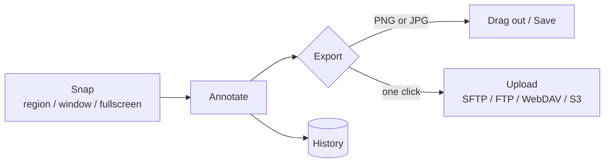

# OpenSnap

A fast, minimal screen-capture and annotation app for macOS 26.

   

## ✨ Features

| | |
| --- | --- |
| 📸 **Snap** | Region (crosshair with magnifier), window, fullscreen and Frame captures. A snap covers the display under the pointer. |
| ⏱️ | Timed snap with an on-screen countdown. |
| ✏️ **Annotate** | Select, arrow, line, rectangle, ellipse, brush, text, fill and eraser tools, colors, sizes, crop and resize, Undo/Redo. |
| 🖼️ **PNG or JPG** | A footer PNG / JPG toggle. PNG keeps transparency; every JPG is written at 75%. The choice applies to drag-out, export, upload and History. |
| 🖱️ **Drag out** | Drag the image straight into Mail, the Desktop or any app. |
| ☁️ **One-click upload** | Upload to SFTP, FTP/FTPS, WebDAV or S3-compatible destinations. Keep several, mark one as the default, and right-click the upload button to switch. |
| 🕘 **History** | Past captures are kept in History for reopening, re-exporting and uploading. |
| 🫧 **Liquid Glass UI** | An icon-only Liquid Glass interface with tooltips on every control. |



## 📋 Requirements

- macOS 26 or newer, Apple Silicon (arm64).
- Screen Recording permission (System Settings > Privacy & Security). Without it captures come back empty.

## 🔨 Build and test

```sh
./tools/build.sh                       # builds build/OpenSnap.app
python3 tools/test.py                  # every suite; add --concurrent-app-safety for the isolation proof
python3 tools/test-native-startup.py   # launches the built app against throwaway storage
./tools/eye-dump-audit.sh OUTDIR       # the only screenshot path: PNGs of an isolated copy of the app's own windows (see below)
sh tools/check-clean-clone.sh          # clones the committed HEAD to a temp dir; builds, checks the bundle and runs every suite there (slow; not part of test.py)
sh tools/release.sh VERSION            # release zip + manifest (see below)
```

Test and harness runs isolate themselves with `OPENSNAP_APP_SUPPORT` (a throwaway storage folder; the one-time data migration never runs when it is set), `OPENSNAP_EVIDENCE_DIR` and, for the startup script, a temporary `CFFIXED_USER_HOME`.

`tools/eye-dump-audit.sh` never runs `build/OpenSnap.app` itself: it copies the bundle, gives the copy a throwaway bundle id (its own defaults domain) and ad-hoc re-signs it, then launches it with a throwaway home, support and evidence folder inside a `sandbox-exec` fence (no network; the real stores, `~/.aws`, `~/.ssh` and Keychains unreadable). The real stores are hashed before and after (`tools/real_store_guard.py`) and the run exits non-zero if any changed (`safety.txt`). Options: `--groups`, `--appearances light,dark`, `--icons sf|fa|both` (`fa` reports "FA unavailable" unless the Font Awesome subsets are bundled) and `--sizes 980xmin,1024x740,1280x800,1440x900,full`.

`tools/check-clean-clone.sh` proves the committed tree needs nothing outside the repository: it clones HEAD into a fresh temp directory with no archive folder, no Font Awesome fonts and no token, then runs `tools/build.sh`, `tools/check-no-original.py build/OpenSnap.app` and `tools/test.py` inside the clone. It never touches this checkout's `build/` and never launches the app. It leaves out `tools/test-native-startup.py`: that script starts the built binary under the real bundle id, and `OPENSNAP_APP_SUPPORT` and `CFFIXED_USER_HOME` do not redirect `UserDefaults`, so on a machine that runs OpenSnap it can read and write the live preferences. Use `tools/eye-dump-audit.sh` for anything that needs the built app running.

Tests print `SKIPPED (FA not bundled)` only for the Font Awesome glyph branch, which needs the licensed Pro subsets that are never committed; any other skipped suite is a failure. `tools/check-no-original.py --sources` fails if anything under `Sources/`, `tests/` or `tools/` names the retired archive folder.

Run `tools/build.sh` before `tools/test-native-startup.py`, and quit a running copy of the app first; the startup script refuses otherwise. The Xcode command line tools provide the Swift toolchain.

The app icon is a Liquid Glass `.icon` built with `actool`, with a flattened `.icns` fallback. The icons in the UI use Font Awesome Pro when it is available and SF Symbols otherwise. The Pro fonts are licensed, so they are optional and never committed: with your own token in `FONTAWESOME_TOKEN`, run `OPENSNAP_FETCH_FONTAWESOME=1 ./tools/build.sh` and the build downloads the package, subsets only the glyphs the app uses into the git-ignored `build/fonts` and bundles them.

## 📦 Releases

`sh tools/release.sh VERSION` runs on a clean tree. It refuses a VERSION that differs from `Info.plist`, refuses uncommitted changes, builds without Font Awesome Pro, copies the bundle to a private staging directory, fails if that copy contains any font file, verifies the signature and writes `build/OpenSnap-VERSION-arm64.zip` plus `build/release-manifest.json` (version, git SHA, binary and zip SHA-256).

Release builds are ad-hoc signed and not notarized, so Gatekeeper blocks the first launch of a downloaded copy. Verify the download first: `shasum -a 256` of the zip must equal `zip_sha256` in the manifest. Then try to open the app once and choose Open Anyway in System Settings > Privacy & Security, or run `xattr -dr com.apple.quarantine` on the app.

This release renames the app to OpenSnap (bundle identifier `com.shoemoney.opensnap`, Application Support folder `OpenSnap`, `.opensnap` documents). On first launch it copies data from the previous app's folder, leaving the old folder untouched, and converts History to the new format. Old `.skitch` files no longer open; existing History is converted once.

## 🕰️ History

OpenSnap began as a rebuild inspired by Skitch.

## 📄 License

MIT. See `LICENSE`.
